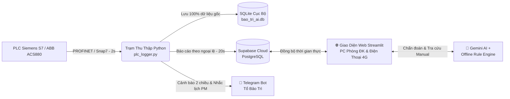

# 🏭 Hệ Thống Giám Sát IIoT & Trợ Lý AI Quản Trị Bảo Trì Nhà Máy

Hệ thống chuyển đổi số công tác **Giám sát Thiết bị Thời gian thực (IIoT)** và **Bảo trì Tự chủ (TPM / PM)** dành cho dây chuyền sản xuất công nghiệp (PLC Siemens S7 & Hệ truyền động Biến tần ABB ACS880). Giải pháp kết nối trực tiếp dữ liệu từ tầng điều khiển hiện trường lên nền tảng đám mây, tích hợp cảnh báo đa kênh và Trợ lý AI chẩn đoán sự cố.

---

## 🏗️ Kiến Trúc Hệ Thống & Luồng Dữ Liệu

Hệ thống vận hành theo mô hình **Local-First & Cloud-Sync** (Ưu tiên xử lý tức thì tại trạm điều khiển và đồng bộ thông minh lên đám mây):



---

## ✨ Các Phân Hệ Chức Năng Chính

### 1. Thu Thập Dữ Liệu & Cảnh Báo Thông Minh (`plc_logger.py`)
* **Đọc dữ liệu công nghiệp thời gian thực:** Kết nối trực tiếp khối dữ liệu `DB` trên PLC Siemens qua thư viện `python-snap7` với chu kỳ quét **2 giây/lần**.
* **Báo cáo theo ngoại lệ (Report by Exception):** Lưu trữ toàn bộ dữ liệu gốc vào SQLite tại trạm, nhưng chỉ đẩy lên Supabase Cloud mỗi **20 giây** hoặc đẩy **tức thì** khi phát hiện thông số biến động mạnh / vượt ngưỡng — giúp tiết kiệm đến **90% dung lượng** đám mây.
* **Cảnh báo Telegram 2 chiều:** Tự động bắn tin nhắn **BÁO ĐỘNG ĐỎ** ngay giây đầu tiên vượt ngưỡng và gửi tin nhắn **XÁC NHẬN PHỤC HỒI** kèm tổng thời gian dừng/lỗi khi thiết bị ổn định trở lại.
* **Nhắc việc bảo dưỡng tự động:** Tự động quét lịch bảo dưỡng định kỳ lúc `07:30` sáng hằng ngày và gửi danh sách hạng mục sắp đến hạn/quá hạn vào nhóm Telegram.

### 2. Bảng Điện Tử Giám Sát Đa Điểm & Sổ Bàn Giao Ca (`modules/tab_giam_sat.py`, `modules/tab_ban_giao.py`)
* **Đồng hồ số & Biểu đồ xu hướng:** Hiển thị trực quan nhiệt độ, dòng điện động cơ (% mang tải), tốc độ, áp suất và sẵn sàng hiển thị thông số biến tần **ABB ACS880** (Tần số Hz, Mô-men xoắn %, Mã lỗi Fault Code).
* **Quản lý ngưỡng động đa điểm (`st.data_editor`):** Cho phép kỹ sư thêm mới vị trí máy, khai báo địa chỉ `DB / Offset` và điều chỉnh ngưỡng cảnh báo trực tiếp trên giao diện Web mà không cần can thiệp mã nguồn.
* **Sổ Nhật Ký Bàn Giao Ca Điện Tử:** Số hóa quy trình giao nhận ca giữa Ca Ngày và Ca Đêm, lưu trữ lịch sử tập trung trên Cloud.

### 3. Trợ Lý AI Chẩn Đoán & Kho Tài Liệu Dùng Chung (`web_chatbot.py`, `modules/bao_tri_nang_cao.py`)
* **Kho Tài Liệu Kỹ Thuật Dùng Chung (Cloud Manual Library):** Lưu trữ tập trung các tài liệu hướng dẫn vận hành, sơ đồ mạch, bảng mã lỗi biến tần trên Cloud; tích hợp bộ lọc trích đoạn thông minh giúp AI tra cứu nhanh và chính xác.
* **Hệ Chuyên Gia Chẩn Đoán Offline Dự Phòng:** Tự động kích hoạt bộ quy tắc chẩn đoán kỹ thuật tại chỗ khi mất kết nối Internet hoặc máy chủ AI gián đoạn.

### 4. Thống Kê KPI, Lịch Bảo Dưỡng PM & Xuất Biên Bản ISO (`modules/tab_bao_cao.py`, `modules/quan_ly_ho_so.py`)
* **Tự động nhận diện ca trực & Xuất Excel ISO:** Tự động lọc dữ liệu theo **Ca Ngày (07:00–19:00)** hoặc **Ca Đêm (19:00–07:00)**, tính toán KPI vận hành và xuất báo cáo Excel 3 sheet chuẩn lưu trữ.
* **Quản lý Hồ sơ Sự cố & Xuất Biên bản Word (.docx):** Theo dõi trạng thái xử lý (`Đang xử lý` / `Đang theo dõi` / `Đã hoàn thành`) và xuất phiếu công tác Word có sẵn khung chữ ký nghiệm thu 3 bên.

---

## 📂 Cấu Trúc Thư Mục Dự Án

```text
tro-ly-bao-tri-ai/
├── plc_logger.py              # Dịch vụ chạy ngầm đọc PLC Siemens, lưu SQLite/Cloud & gửi Telegram
├── web_chatbot.py             # Ứng dụng Web giao diện chính (Streamlit)
├── requirements.txt           # Danh sách thư viện Python cần thiết
├── chay_plc_tudong.bat        # Script khởi động nhanh trạm thu thập PLC trên Windows
├── chay_web_noidia.bat        # Script mở giao diện Web nội bộ qua mạng LAN nhà máy
└── modules/
    ├── tab_giam_sat.py        # Giao diện Tab 1: Đồng hồ số, biểu đồ & bảng cấu hình đa điểm
    ├── tab_ban_giao.py        # Phân hệ Sổ Nhật Ký Bàn Giao Ca điện tử
    ├── tab_bao_cao.py         # Giao diện Tab 3: Thống kê KPI theo ca & xuất báo cáo Excel ISO
    ├── quan_ly_ho_so.py       # Quản lý hồ sơ sự cố Cloud & xuất Biên bản Word chuẩn ISO
    └── bao_tri_nang_cao.py    # Kho tài liệu dùng chung, chẩn đoán Offline & Lịch bảo dưỡng PM
```

---

## 🚀 Hướng Dẫn Triển Khai Nhanh

1. **Cài đặt thư viện:**
   ```bash
   pip install -r requirements.txt
   ```
2. **Cấu hình biến môi trường (`.env`):**
   Tạo tệp `.env` tại thư mục gốc với các thông số kết nối thực tế:
   ```env
   PLC_IP=192.168.0.1
   PLC_RACK=0
   PLC_SLOT=1
   PLC_DB_NUMBER=3
   GEMINI_API_KEY=your_gemini_api_key
   SUPABASE_URL=your_supabase_url
   SUPABASE_KEY=your_supabase_anon_key
   TELEGRAM_TOKEN=your_telegram_bot_token
   TELEGRAM_CHAT_ID=your_telegram_chat_id
   APP_PASSWORD=mat_khau_noi_bo
   ```
3. **Vận hành hệ thống:**
   * Chạy **`chay_plc_tudong.bat`** trên máy tính trạm để thu thập dữ liệu PLC và cảnh báo Telegram 24/7.
   * Chạy **`chay_web_noidia.bat`** để mở giao diện giám sát nội bộ qua mạng LAN xưởng (hoặc truy cập qua Streamlit Cloud bằng mạng 4G).
